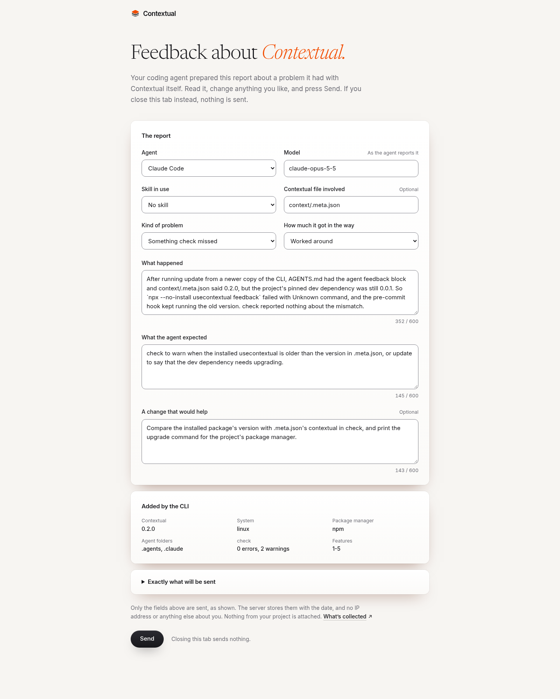
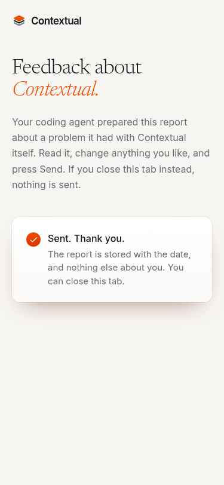

# Agent feedback, tried for real

13 November 2026, in Claude Code (Opus 5.5), with the 0.2.0 CLI from the `feat/agent-feedback` branch.

## The trial

1. A copy of the Pantry trial repo, whose `package.json` pins `usecontextual` 0.0.1. `update` from the 0.2.0 CLI, then `feedback on`.
2. **A real problem.** The context said 0.2.0 and `AGENTS.md` had the feedback block, but the block's command, `npx --no-install usecontextual feedback`, ran the installed 0.0.1 and failed with `Unknown command "feedback"`; the pre-commit hook was running 0.0.1 too. `check` said nothing about the mismatch.
3. After installing the packed 0.2.0 into the repo, the block's own command built the report:

   ```bash
   npx --no-install usecontextual feedback --print --harness claude-code --model claude-opus-5-5 --skill none \
     --category check-miss --severity worked-around --file context/.meta.json \
     --happened "After running update from a newer copy of the CLI, …" --expected "check to warn when …" --suggestion "Compare …"
   ```

   It printed a 1,745-character link with the whole report after `#report=`, and added: Contextual 0.2.0, linux, npm, `.agents` and `.claude`, `check` 0 errors and 2 warnings, features 1-5.
4. The same fragment opened the form on a local build of the site, and every field was filled in:

   

5. The other states, at 375px: the focus ring, a Send error, the sent state below (with the report gone from the address bar), and a link with no report. The form sent exactly the fields it showed.

   

No row was stored: no database was connected yet, so the server answered "Feedback can't be stored right now. Nothing was sent.", as designed.

## The first reports

The places Contextual got in the way while building 0.2.0, prepared with `usecontextual feedback` on this repo. They go through the form once the database is connected.

| Kind | How much | What happened |
|---|---|---|
| check-miss | worked around | The trial above: the installed CLI was older than the context, and `check` didn't say so |
| hook-friction | worked around | In the repo that builds the CLI, the hook ran the last published version, so a branch's new rules were checked by the old ones; a hand-edited hook line was undone by `update` without a word (issue #2) |
| token-cost | annoyance | One change to shared code needed log entries in five features in the same commit |
| check-false-alarm | annoyance | A feature in progress got one "matches no files" warning per planned path, on every commit, until its code existed |
| token-cost | annoyance | `which` takes one path, so checking the owners of forty files takes forty calls |
